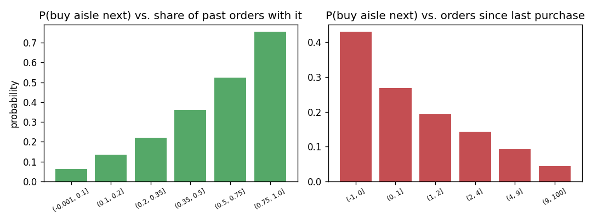

# Product-category affinity prediction: which categories will a user buy next?

[](https://github.com/ksenia-ossi/product-affinity/actions/workflows/checks.yml)

End-to-end recommender pipeline on the public
[Instacart Online Grocery Shopping Dataset 2017](https://www.kaggle.com/c/instacart-market-basket-analysis)
(3.4M orders, 206k users, 50k products in 134 aisles / 21 departments, 34M order lines).

**Business question:** given a user's purchase history, how strongly is she attracted to each
product category (*aisle*)? Ranking candidate aisles from a catalogue of 134 categories is the
building block behind "recommend a category / brand to this user" and category-level ad targeting.

```
CSVs ──> PostgreSQL (COPY, SQL exploration + aggregation) ──> parquet ──> pandas EDA ──> candidates ──> rankers ──> top-k metrics
```

## Results (26k held-out users, aisles ranked for each user's next order)

| model                                         | precision@5 | recall@10 | NDCG@10 | hit-rate@10 | AUC   |
|:----------------------------------------------|------------:|----------:|--------:|------------:|------:|
| popularity (same list for everyone)           | 0.372       | 0.393     | 0.429   | 0.885       | –     |
| user history (share of past orders)           | 0.512       | 0.580     | 0.609   | 0.960       | –     |
| ALS matrix factorisation (`implicit`)         | 0.334       | 0.476     | 0.427   | 0.930       | –     |
| LightGBM on history + recency + popularity    | **0.529**   | **0.594** | **0.626** | **0.963** | 0.832 |

Full tables: [reports/metrics.md](reports/metrics.md) · SQL: [reports/sql_exploration.md](reports/sql_exploration.md) · EDA: [reports/eda.md](reports/eda.md)

### Candidate retrieval vs ranking

Each user's candidate set is the union of their historical aisles and the top-20 popular
aisles, not necessarily all 134 categories. A ranker cannot recover a relevant aisle that
never entered this set. On the next `make train` run, the report also includes:

- **Candidate recall:** the mean fraction of each user's true next-order aisles found in
  the candidate set. This is an upper bound on recall@k, not an achieved ranking score.
- **Candidate hit rate:** the fraction of held-out users with at least one positive candidate.
- **Candidates per user:** the mean candidate list size, to make the retrieval cost visible.

These metrics weight users equally and include users without candidates. Users without
positive labels contribute zero candidate recall. This separates retrieval losses from
ranking losses and helps evaluate the trade-off when changing the number of popular candidates.
The saved results above predate these diagnostics; no new full-dataset run is claimed here.



## What I learned from the data (SQL + pandas)

- **Repeat behaviour dominates.** 80.8% of the aisles in a user's next order were already in her
  history (SQL: `repeat_share_in_target_order`). A per-user "share of past orders containing the
  aisle" is therefore a very strong baseline — it beats collaborative filtering by a wide margin.
- **Recency matters on top of frequency.** P(buy aisle next) is 0.43 if the aisle was in the last
  order and falls to 0.05 after 9+ orders without it; it rises monotonically from 0.06 to 0.75 with
  the share of past orders containing it (figure above). Both are features of the LightGBM model.
- **Popularity is a Pareto distribution.** `fresh fruits` is in 56% of all orders, the median aisle
  in ~2%. Popularity alone already gives hit-rate@10 = 0.88, so every model must be compared to it.
- **Habit ≠ popularity.** Reorder rate ranges from 0.67 (dairy eggs) to 0.32 (personal care):
  some categories are routine, others are one-off purchases — the aisle-level `a_reorder_rate` feature.
- **Why ALS underperforms here:** with only 134 items and strongly repetitive users, the user's own
  history is far more informative than "similar users"; factorisation shines when the catalogue is
  large and sparse (products, not aisles). See *Next steps*.
- **Evaluation design.** Split by *user* (train rankers on 105k users, evaluate on 26k unseen users)
  and by *time* within each user (history = all prior orders, target = most recent order), so no
  information from the target order leaks into the features. Recall is computed against *all*
  positives, including aisles that never made it into the candidate list.

## Repository layout

```
src/affinity/
  config.py       paths, evaluation cut-offs, split settings
  download.py     fetch the six CSVs from a Hugging Face mirror
  db.py           PostgreSQL schema + COPY (34M rows in ~25 s), exploration SQL -> Markdown,
                  feature SQL -> parquet
  sql/            schema.sql, explore.sql, features.sql (user x aisle history/recency aggregates)
  features.py     candidate generation (history ∪ top-20 popular), user-level split, labels
  metrics.py      candidate recall/coverage/size; precision@k, recall@k, NDCG@k, hit-rate@k
  eda.py          pandas/Matplotlib EDA -> reports/eda.md + figures
  train.py        popularity, user-history, ALS, LightGBM; results table + figures
  serve.py        FastAPI app: loads the logged LightGBM model from MLflow, ranks candidate aisles
tests/            pytest for metrics, candidate construction, training and the API
reports/          generated tables and figures
```

## Run it

```bash
pip install -r requirements.txt
make data        # ~700 MB of CSVs
make db-load     # docker compose up + schema + COPY into PostgreSQL
make sql         # exploration queries -> reports/sql_exploration.md
make features    # SQL aggregation -> data/processed/*.parquet (~1.5 min)
make eda         # figures + reports/eda.md
make train       # four rankers -> reports/metrics.md + an MLflow run (~1 min on 8 cores)
make mlflow-ui   # compare logged runs at http://127.0.0.1:5000
make serve       # REST API with the latest logged LightGBM model, docs at http://127.0.0.1:8000/docs
make test
```

Requires Python ≥ 3.10 and Docker (for PostgreSQL). Peak RAM ≈ 5 GB.

## Experiment tracking (MLflow)

Each `make train` is logged as one MLflow run named `rankers` in the `product-affinity`
experiment, stored locally in `mlflow.db` (SQLite) and `mlruns/` (artifacts), both git-ignored.

- **Parent run:** split settings, candidate-retrieval metrics, `metrics.md` and the figures.
- **One nested run per ranker:** its hyperparameters and metrics (`precision_at_5`, `ndcg_at_10`, ...;
  MLflow metric names cannot contain `@`). AUC and log-loss are logged for LightGBM.
- **LightGBM model:** saved with `mlflow.lightgbm` and an input example, so a logged version can be
  loaded back with `mlflow.lightgbm.load_model`.

`make mlflow-ui` opens the run list, where runs can be compared after changing a hyperparameter.
Set `MLFLOW_TRACKING_URI` to log to another tracking server instead of the local file.

## Serving the model (FastAPI)

`make serve` starts a small REST API. At startup it loads the most recent LightGBM model logged
by `make train` from MLflow (or the one in `MODEL_URI`, e.g. `models:/m-...`), so the API always
serves a model whose parameters and metrics can be looked up in the MLflow UI.

- `GET /health`: status and the URI of the loaded model.
- `POST /rank`: takes a user's candidate aisles, one object per aisle with every model feature
  (the columns of `MODEL_COLUMNS` in `features.py`, including `aisle_id`), and returns the top `k`
  aisles sorted by predicted probability of being in the next order.

```bash
curl -X POST http://127.0.0.1:8000/rank -H 'Content-Type: application/json' \
     -d '{"k": 3, "candidates": [{"aisle_id": 24, "department_id": 4, "ua_order_share": 0.8, ...}, ...]}'
```

A request with a missing feature is rejected with HTTP 422 and the list of missing columns.
The API does not compute features itself: the caller sends the same per-candidate features
that `features.py` builds from the SQL aggregates.

## Development checks

```bash
python3 -m venv .venv
.venv/bin/python -m pip install -r requirements-dev.txt
make check PY=.venv/bin/python
```

GitHub Actions runs the same lint, type and pytest checks on Python 3.10 and 3.12 for
pull requests and pushes to `main`. No dataset download, database or credentials are needed.
The lint check covers Python errors and unused imports, not code formatting; type checking
includes untyped function bodies but skips unavailable third-party stubs.

Tests cover candidate construction, user-level splitting, retrieval and ranking metrics,
and report generation, including the MLflow runs logged by training. API tests log a small model
to a temporary MLflow store and call `/health` and `/rank` through FastAPI's test client. A small synthetic-parquet smoke test exercises candidate generation,
all four rankers and output files in a temporary directory. It checks that the pipeline runs
after SQL aggregation, not model quality or PostgreSQL ingestion. Synthetic scores are never
published as benchmark results, and the saved Instacart reports are not overwritten.

## Next steps

- [ ] Replace the pointwise classifier with `LGBMRanker` (lambdarank, one group per user) and
      compare NDCG@10.
- [ ] Feed the ALS score to LightGBM as a feature instead of using it standalone (classic
      two-stage recommender: candidates + learned re-ranker).
- [ ] Go one level deeper: predict *products* (50k items) instead of aisles — the regime where
      matrix factorisation and item-item similarity become useful.
- [ ] Add a cold-start evaluation: users with ≤ 5 orders only.
- [ ] Calibrate the LightGBM probabilities (reliability curve) so that scores are usable as
      affinity *probabilities*, not only for ranking.
