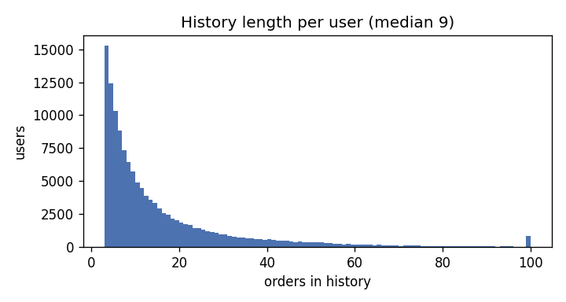
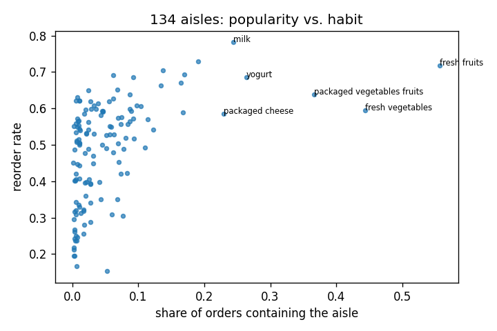

# EDA — Instacart purchase histories (131k labelled users)

- Labelled users: **131,209**; (user, aisle) pairs in history: **3,647,699** (median 25 distinct aisles per user).
- Aisles in the next order: median **7** per user (so the positive rate among history pairs is 21.94%).
- **80.8%** of the aisles bought in the next order were already in the user's history — repeat behaviour dominates; the remaining 19.2% need popularity / collaborative signals.

## P(aisle in next order) by share of past orders containing it

| share_bin     |   p_label |       pairs |
|:--------------|----------:|------------:|
| (-0.001, 0.1] |     0.063 | 1144052.000 |
| (0.1, 0.2]    |     0.135 |  904765.000 |
| (0.2, 0.35]   |     0.221 |  726972.000 |
| (0.35, 0.5]   |     0.362 |  361137.000 |
| (0.5, 0.75]   |     0.525 |  312344.000 |
| (0.75, 1.0]   |     0.755 |  198429.000 |

## P(aisle in next order) by orders since the aisle was last bought

| recency_bin   |   p_label |      pairs |
|:--------------|----------:|-----------:|
| (-1, 0]       |     0.430 | 978193.000 |
| (0, 1]        |     0.268 | 553278.000 |
| (1, 2]        |     0.194 | 403926.000 |
| (2, 4]        |     0.143 | 502661.000 |
| (4, 9]        |     0.093 | 581019.000 |
| (9, 100]      |     0.044 | 628622.000 |

## Figures

